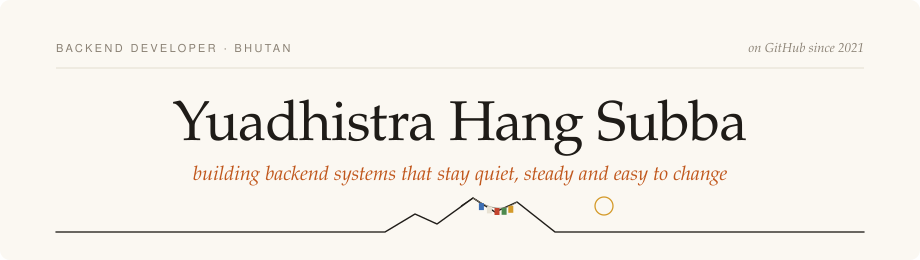
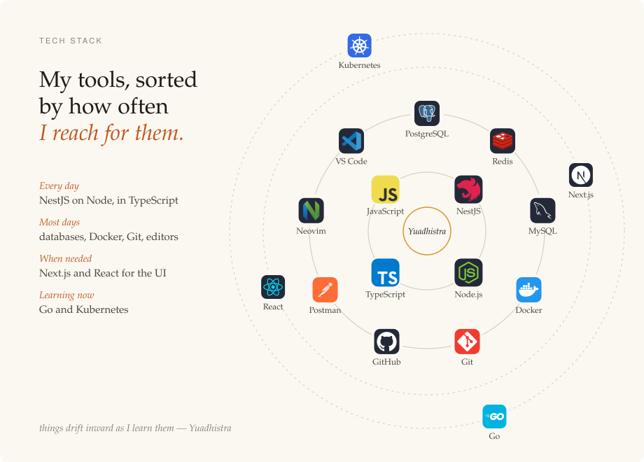
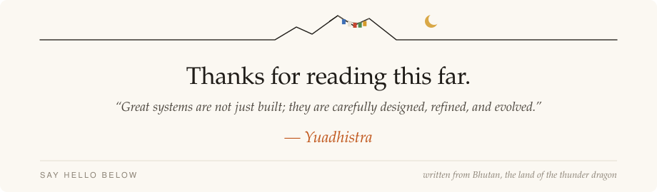

<picture>
  <source media="(prefers-color-scheme: dark)" srcset="./assets/header-dark.svg" />
  <source media="(prefers-color-scheme: light)" srcset="./assets/header.svg" />
  
</picture>

 

&nbsp;

 

---

## 🧑‍💻 &nbsp;About Me

<picture>
  <source media="(prefers-color-scheme: dark)" srcset="./assets/about-me-dark.svg" />
  <source media="(prefers-color-scheme: light)" srcset="./assets/about-me.svg" />
  
</picture>

 

---

## 🚀 &nbsp;Tech Stack

<picture>
  <source media="(prefers-color-scheme: dark)" srcset="./assets/tech-stack-dark.svg" />
  <source media="(prefers-color-scheme: light)" srcset="./assets/tech-stack.svg" />
  
</picture>

 

---

## 📊 &nbsp;GitHub Stats

<picture>
  <source media="(prefers-color-scheme: dark)" srcset="https://raw.githubusercontent.com/yuadhistrahangsubba/yuadhistrahangsubba/output/dashboard-dark.svg" />
  <source media="(prefers-color-scheme: light)" srcset="https://raw.githubusercontent.com/yuadhistrahangsubba/yuadhistrahangsubba/output/dashboard.svg" />
  
</picture>

 

---

## 📈 &nbsp;Contribution Activity

<picture>
  <source media="(prefers-color-scheme: dark)" srcset="https://raw.githubusercontent.com/yuadhistrahangsubba/yuadhistrahangsubba/output/activity-graph-dark.svg" />
  <source media="(prefers-color-scheme: light)" srcset="https://raw.githubusercontent.com/yuadhistrahangsubba/yuadhistrahangsubba/output/activity-graph.svg" />
  
</picture>

 

---

## 🏆 &nbsp;Achievements

<picture>
  <source media="(prefers-color-scheme: dark)" srcset="https://raw.githubusercontent.com/yuadhistrahangsubba/yuadhistrahangsubba/output/trophies-dark.svg" />
  <source media="(prefers-color-scheme: light)" srcset="https://raw.githubusercontent.com/yuadhistrahangsubba/yuadhistrahangsubba/output/trophies.svg" />
  
</picture>

 

---

<picture>
  <source media="(prefers-color-scheme: dark)" srcset="./assets/footer-dark.svg" />
  <source media="(prefers-color-scheme: light)" srcset="./assets/footer.svg" />
  
</picture>

**[LinkedIn](https://www.linkedin.com/in/yuadhistra-hang-subba-0791633b3/)** &nbsp;·&nbsp; **[Facebook](https://www.facebook.com/ram.subba.5015/)** &nbsp;·&nbsp; **[Instagram](https://www.instagram.com/y.d.luffy9/)**

